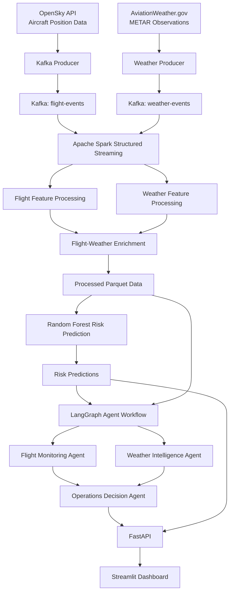
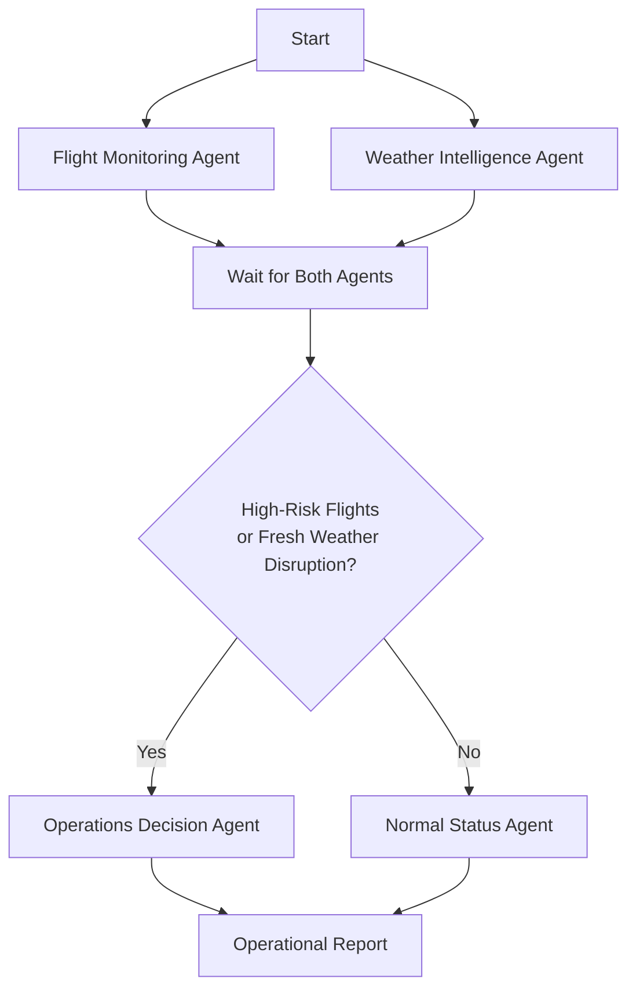
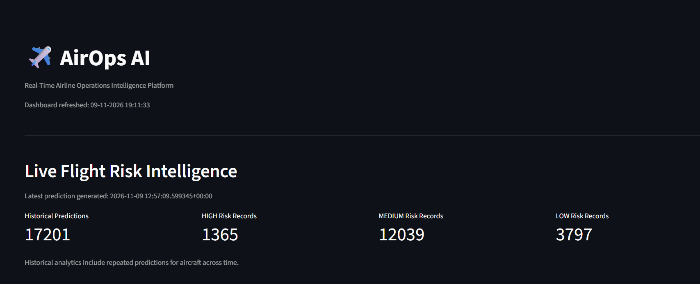
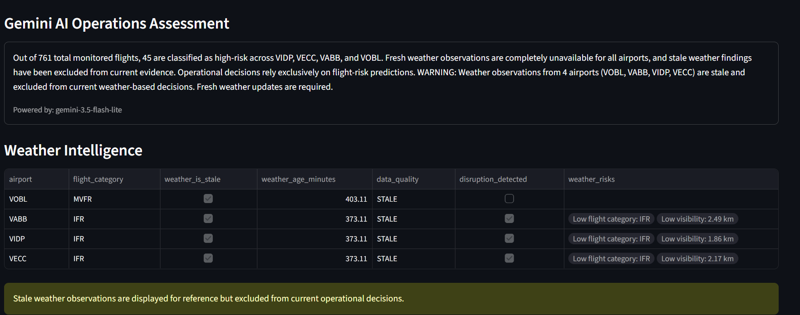
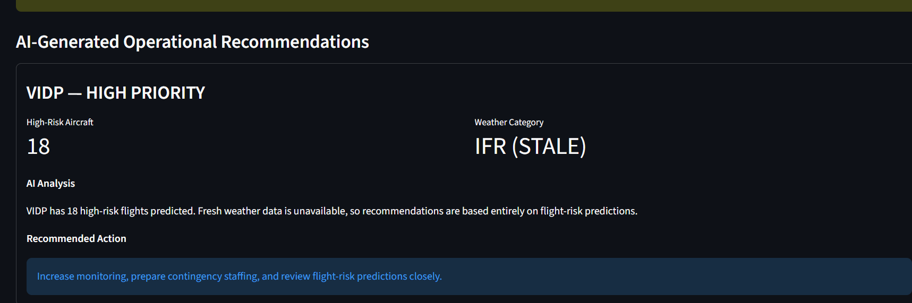
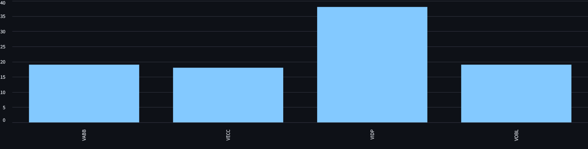

# AirOps AI — Airline Operations Intelligence Platform

**A near-real-time airline operations intelligence platform powered by Kafka, Apache Spark, Machine Learning, LangGraph, and Generative AI.**

AirOps AI integrates live aircraft-position data and aviation weather observations into a streaming analytics pipeline. It processes flight events, enriches them with nearby airport weather conditions, predicts operational risk using a Random Forest model, and generates AI-assisted operational recommendations through specialized LangGraph agents.

---

## 1. Problem Statement

Airline operations involve monitoring multiple sources of information, including aircraft positions, airport traffic, and changing weather conditions.

When these sources are analyzed separately, identifying potential operational risks becomes difficult and time-consuming.

AirOps AI addresses this problem by building a unified intelligence platform that:

- Collects aircraft-position data and aviation weather observations.
- Processes incoming events through a distributed streaming architecture.
- Associates aircraft with nearby airport weather conditions.
- Predicts operational risk using Machine Learning.
- Uses AI agents to analyze flight and weather conditions.
- Generates evidence-based operational recommendations through an interactive dashboard.

## 2. System Architecture

The platform follows an event-driven architecture with separate ingestion, streaming, prediction, orchestration, and presentation layers.



### Architecture Components

| Layer | Technology | Responsibility |
|---|---|---|
| Data Ingestion | Python, OpenSky API | Collect aircraft-position events |
| Weather Ingestion | AviationWeather.gov | Collect METAR observations |
| Message Broker | Apache Kafka | Stream flight and weather events |
| Stream Processing | Apache Spark | Clean, transform, and enrich events |
| Data Storage | Apache Parquet | Store processed datasets and predictions |
| Machine Learning | Scikit-learn | Classify flight operational risk |
| Agent Orchestration | LangGraph | Coordinate specialized AI agents |
| LLM Integration | Gemini, LangChain | Generate operational assessments |
| API Layer | FastAPI | Expose prediction and reporting endpoints |
| Dashboard | Streamlit | Display operational intelligence |
| Tool Integration | MCP | Expose flight, weather, and risk tools |
| Infrastructure | Docker Compose | Run Kafka and Spark services |

## 3. Data Sources

### OpenSky Network

Provides aircraft-position information used to monitor flight activity.

Data includes:
- ICAO24 aircraft identifier
- Callsign
- Latitude and longitude
- Barometric altitude
- Velocity
- Vertical rate
- On-ground status
- Position timestamp

**Kafka topic:** `flight-events`

### AviationWeather.gov

Provides METAR aviation weather observations for four Indian airports:

| Airport Code | Airport |
|---|---|
| VIDP | Indira Gandhi International Airport |
| VABB | Chhatrapati Shivaji Maharaj International Airport |
| VECC | Netaji Subhas Chandra Bose International Airport |
| VOBL | Kempegowda International Airport |

Weather information includes:
- Temperature
- Wind speed
- Visibility
- Flight category
- Observation timestamp

**Kafka topic:** `weather-events`

## 4. Streaming Data Pipeline

Apache Kafka and Spark Structured Streaming form the core of the data-processing architecture.

### Step 1: Event Ingestion

Python producers collect flight and weather information and publish events to separate Kafka topics.

- Flight ingestion interval: approximately 60 seconds.
- Weather ingestion interval: approximately 300 seconds.

### Step 2: Stream Processing

Spark Structured Streaming consumes Kafka events and performs:

- JSON parsing and schema validation.
- Missing-value and invalid-record handling.
- Flight feature engineering.
- Weather feature transformation.
- Unit conversion.

Examples:
- Flight velocity: metres/second to kilometres/hour.
- Altitude: metres to feet.
- Wind speed: knots to kilometres/hour.

### Step 3: Airport Proximity Analysis

The system uses the Haversine distance formula to calculate the distance between aircraft coordinates and airport locations.

- Airport proximity radius: 100 km.
- Nearest airport identification.
- Latest available weather observation per airport.
- Left join to preserve flight records even when weather information is unavailable.

### Step 4: Weather Freshness Validation

Weather observations are checked against their timestamps.

The streaming enrichment pipeline uses a six-hour stale-weather threshold. The Weather Intelligence Agent applies a stricter 30-minute freshness threshold when preparing current operational decisions.

Weather freshness is therefore explicitly considered before generating operational recommendations.

### Step 5: Airport Traffic Analytics

The airport traffic pipeline calculates aircraft activity using:

- Five-minute event-time windows.
- Ten-minute watermark.
- Approximate distinct aircraft counts.

Processed datasets are stored in Parquet format.

## 5. Machine Learning Risk Prediction

AirOps AI uses a Random Forest Classifier to classify aircraft operational risk.

### Input Features

The model uses seven features:

1. `distance_km`
2. `temperature_c`
3. `wind_speed_kmh`
4. `visibility_km`
5. `altitude_ft`
6. `velocity_kmh`
7. `flight_category_score`

### Model Architecture

```text
Input Flight and Weather Features
              |
              v
        SimpleImputer
       (Median Strategy)
              |
              v
   Random Forest Classifier
       (100 Estimators)
              |
              v
       Risk Classification
              |
       -----------------
       |       |       |
      LOW   MEDIUM   HIGH
```

### Training Methodology

- Risk labels are generated using predefined weather and proximity rules.
- Data is split chronologically into 75% training and 25% testing.
- A median imputation strategy handles missing feature values.
- A Random Forest Classifier is trained with balanced class weights.
- The final model is retrained on the complete available dataset.

### Prediction Pipeline

The prediction service:

1. Reads newly processed flight-weather records.
2. Identifies records that have not previously been predicted.
3. Prepares the required model features.
4. Generates risk classifications and class probabilities.
5. Stores predictions in Parquet format.
6. Checks for new records every 30 seconds.

Each prediction includes:
- Aircraft identifier
- Predicted risk level
- Risk confidence
- Class probabilities
- Prediction timestamp
- Model version

**Important:** The current training labels are rule-generated proxy labels rather than verified historical airline disruption outcomes. Consequently, model predictions represent learned rule-based risk classifications, not independently validated probabilities of flight delays or cancellations.

## 6. Operational Risk Assessment

The project also implements a separate rule-based operational risk calculation.

It combines weather conditions and airport proximity:

| Condition | Risk |
|---|---|
| LIFR weather category | High weather risk |
| IFR weather category | Medium weather risk |
| MVFR weather category | Low weather risk |
| Distance ≤ 25 km | High proximity risk |
| Distance ≤ 60 km | Medium proximity risk |

The combined operational risk is classified as:

- CRITICAL
- HIGH
- MEDIUM
- LOW

This rule-based assessment is separate from the Random Forest classifier, which produces LOW, MEDIUM, and HIGH predictions.

## 7. AI Agent Architecture

AirOps AI uses LangGraph to coordinate three specialized agents.

### 1. Flight Monitoring Agent

Responsible for:
- Reading the latest aircraft risk predictions.
- Identifying unique monitored aircraft.
- Counting high-risk flights.
- Calculating airport-wise high-risk aircraft counts.
- Identifying aircraft requiring attention.

### 2. Weather Intelligence Agent

Responsible for:
- Retrieving airport weather information through MCP tools.
- Checking observation freshness.
- Identifying adverse weather categories.
- Detecting high wind and low visibility conditions.
- Determining whether fresh weather observations indicate potential disruption.

### 3. Operations Decision Agent

Responsible for:
- Combining flight risk and weather intelligence.
- Generating operational assessments using Gemini.
- Producing airport-specific recommendations.
- Validating the generated response against available evidence.

### LangGraph Workflow



The Flight Monitoring and Weather Intelligence agents execute in parallel.

The workflow routes to the Operations Decision Agent when high-risk flights exist or fresh weather observations indicate disruption. Stale weather observations cannot independently trigger this decision path.

The LLM is instructed to use only the supplied evidence and avoid inventing flight counts, weather conditions, delays, or cancellations.

## 8. Model Context Protocol (MCP)

The project includes an MCP server that exposes operational datasets through three read-only tools:

| MCP Tool | Purpose |
|---|---|
| `live_flights` | Retrieve processed flight information |
| `airport_weather` | Retrieve airport weather observations |
| `risk_predictions` | Retrieve aircraft risk predictions |

These tools allow compatible AI clients and agent workflows to access structured operational information.

## 9. FastAPI Backend

FastAPI provides an interface between the analytics pipeline, agent workflow, and dashboard.

### Available Endpoints

| Method | Endpoint | Description |
|---|---|---|
| GET | `/` | API health information |
| POST | `/predict` | Generate an individual risk prediction |
| GET | `/operations/report` | Generate an AI-assisted operational report |

Interactive API documentation is available through Swagger UI.

```text
http://127.0.0.1:8000/docs
```

## 10. Streamlit Dashboard

The Streamlit dashboard provides an integrated view of flight activity, risk predictions, airport traffic, weather intelligence, and AI-generated recommendations.

### Dashboard Features

- Total monitored aircraft.
- High-risk aircraft count.
- Historical risk distribution.
- Airport-wise risk analysis.
- Airport traffic analytics.
- Weather observation freshness.
- AI-generated operational assessment.
- Airport-specific operational recommendations.
- Automatic dashboard refresh.

### Dashboard Screenshots

#### 1. Dashboard Overview



#### 2. Weather Intelligence



#### 3. AI Operational Recommendations



#### 4. Airport Traffic Analytics



#### 5. Historical Risk Distribution


## 11. Observed Results

The following figures represent an observed dashboard snapshot during project execution, not fixed system capacity or independently validated performance benchmarks.

| Metric | Observed Value |
|---|---:|
| Unique Aircraft Monitored | 761 |
| High-Risk Aircraft | 45 |
| Historical Predictions | 17,201 |
| Airports Monitored | 4 |
| AI-Generated Recommendations | 4 |

The platform successfully demonstrated:

- Kafka-based flight and weather event ingestion.
- Spark-based streaming and feature enrichment.
- Airport proximity and weather association.
- Automated ML risk prediction.
- Multi-agent operational analysis.
- API-based reporting.
- Interactive dashboard visualization.

## 12. Technology Stack

| Category | Technologies |
|---|---|
| Programming Language | Python 3.11 |
| Data Ingestion | Requests, Kafka-Python |
| Message Streaming | Apache Kafka 4.1.1 |
| Stream Processing | Apache Spark 4.0.1, PySpark |
| Data Processing | Pandas, NumPy |
| Storage | Apache Parquet |
| Machine Learning | Scikit-learn, Random Forest |
| AI Orchestration | LangGraph |
| LLM Integration | Gemini, LangChain |
| API Development | FastAPI, Uvicorn |
| Dashboard | Streamlit |
| Tool Integration | MCP, FastMCP |
| Containerization | Docker, Docker Compose |
| Data Sources | OpenSky Network, AviationWeather.gov |

## 13. Project Structure

```text
AirOps-AI/
│
├── agents/
│   ├── flight_monitor_agent.py
│   ├── weather_intelligence_agent.py
│   └── operations_agent.py
│
├── api/
│   └── main.py
│
├── config/
│   └── settings.py
│
├── dashboard/
│   └── app.py
│
├── ingestion/
│   ├── opensky/
│   │   └── producer.py
│   └── weather/
│       └── producer.py
│
├── infrastructure/
│   └── docker/
│       └── docker-compose.yml
│
├── mcp_server/
│   ├── flight_tools.py
│   ├── weather_tools.py
│   ├── risk_tools.py
│   └── server.py
│
├── ml/
│   ├── models/
│   ├── prediction/
│   │   └── predict_risk.py
│   └── training/
│       └── train_risk_model.py
│
├── orchestration/
│   └── workflows/
│       └── airops_workflow.py
│
├── streaming/
│   └── spark/
│       ├── session.py
│       ├── kafka_consumer.py
│       ├── weather_consumer.py
│       ├── flight_processor.py
│       ├── weather_processor.py
│       ├── flight_weather_join.py
│       └── airport_traffic.py
│
├── screenshots/
│   ├── 01-dashboard-overview.png
│   ├── 02-weather-intelligence.png
│   ├── 03-ai-operational-recommendation.png
│   ├── 04-airport-traffic-chart.png
│   └── 05-historical-risk-distribution.png
│
├── tests/
├── .env.example
├── .gitignore
└── README.md
```

## 14. Installation and Setup

### Prerequisites

Install the following:

- Python 3.11
- Docker Desktop
- Docker Compose
- Git

### Step 1: Clone the Repository

```bash
git clone https://github.com/mdrajaistekhar786/AirOps-AI.git

cd AirOps-AI
```

### Step 2: Create a Virtual Environment

Windows PowerShell:

```powershell
python -m venv .venv

.venv\Scripts\Activate.ps1
```

### Step 3: Install Dependencies

```bash
pip install -r requirements.txt
```

### Step 4: Configure Environment Variables

Create a `.env` file using `.env.example` as a reference.

Configure the required API credentials and application settings, including the Gemini API key and model configuration.

Do not commit `.env` or expose API credentials publicly.

### Step 5: Start Kafka and Spark

```bash
docker compose -f infrastructure/docker/docker-compose.yml up -d
```

Verify the containers:

```bash
docker ps
```

### Step 6: Start Flight Data Ingestion

```bash
python ingestion/opensky/producer.py
```

### Step 7: Start Weather Data Ingestion

Open another terminal:

```bash
python ingestion/weather/producer.py
```

### Step 8: Start Spark Flight-Weather Processing

Open another terminal:

```bash
docker exec -it airops-spark-master bash -lc "cd /opt/airops && /opt/spark/bin/spark-submit --conf spark.jars.ivy=/tmp/spark-ivy --packages org.apache.spark:spark-sql-kafka-0-10_2.13:4.0.1 streaming/spark/flight_weather_join.py"
```

Keep the streaming process running.

### Step 9: Start ML Risk Prediction

```bash
python -m ml.prediction.predict_risk
```

The prediction service checks for new records every 30 seconds.

### Step 10: Start FastAPI

```bash
uvicorn api.main:app --reload
```

API documentation:

```text
http://127.0.0.1:8000/docs
```

### Step 11: Start Streamlit Dashboard

Open another terminal:

```bash
streamlit run dashboard/app.py
```

Dashboard:

```text
http://localhost:8501
```

**Note:** The commands above assume the project is configured with the Docker paths and environment variables used during development. Verify `.env.example` and `requirements.txt` before running the application.

## 15. Limitations

The current implementation is a demonstration and engineering prototype. Some limitations remain:

1. **OpenSky API rate limits:** Anonymous API requests can receive HTTP 429 responses, interrupting fresh flight ingestion.
2. **Weather freshness:** Weather observations may become stale when new METAR data is unavailable.
3. **Proxy ML labels:** The model is trained on rule-generated labels rather than verified historical disruption outcomes. Its evaluation should not be interpreted as independent real-world disruption prediction performance.
4. **Prediction scalability:** The current prediction process periodically reads accumulated Parquet datasets into Pandas, which may become inefficient as data volume grows.
5. **Operational validation:** The platform has not been validated against real airline dispatch, delay, or cancellation outcomes.
6. **API feature alignment:** The individual prediction endpoint requires its feature schema to match the seven-feature model training pipeline.

## 16. Future Improvements

- Implement authenticated OpenSky access and more robust ingestion retries.
- Introduce incremental processing and scalable storage.
- Train and evaluate the risk model using verified historical disruption data.
- Improve ML evaluation with time-based validation and operational metrics.
- Align API prediction features with the trained model artifact.
- Improve real-time airport traffic calculations.
- Add monitoring, logging, and failure recovery.
- Deploy the platform using a cloud infrastructure.
- Extend the agent workflow with additional operational intelligence tools.

## 17. Key Learning Outcomes

This project demonstrates practical implementation of:

- Event-driven data engineering using Apache Kafka.
- Distributed stream processing using Apache Spark.
- Real-time feature engineering and data enrichment.
- Machine Learning model development and inference pipelines.
- Multi-agent orchestration using LangGraph.
- LLM integration for evidence-based operational recommendations.
- MCP-based tool integration.
- REST API development using FastAPI.
- Interactive analytics using Streamlit.
- Containerized infrastructure using Docker Compose.

---

## Author

**Md Raja Istekhar**

Integrated M.Sc. Quantitative Economics and Data Science  
Birla Institute of Technology, Mesra

**GitHub:** [mdrajaistekhar786](https://github.com/mdrajaistekhar786)

**Project Repository:** [AirOps-AI](https://github.com/mdrajaistekhar786/AirOps-AI)

---

*AirOps AI — Turning Flight and Weather Streams into Operational Intelligence.*
